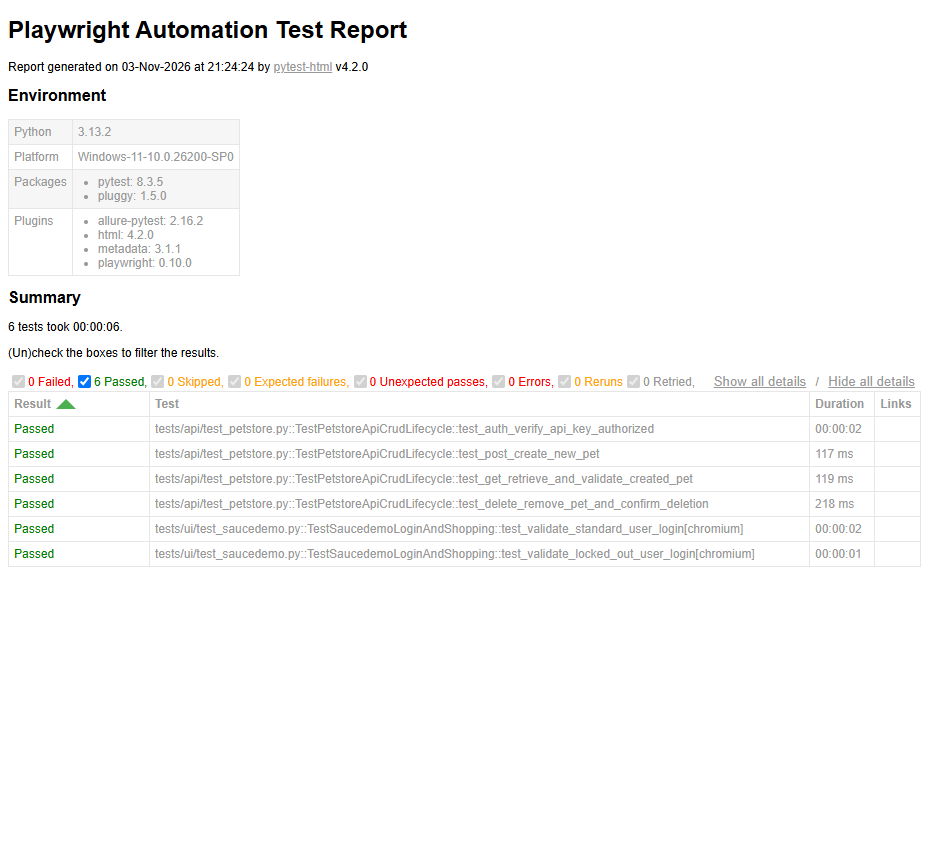
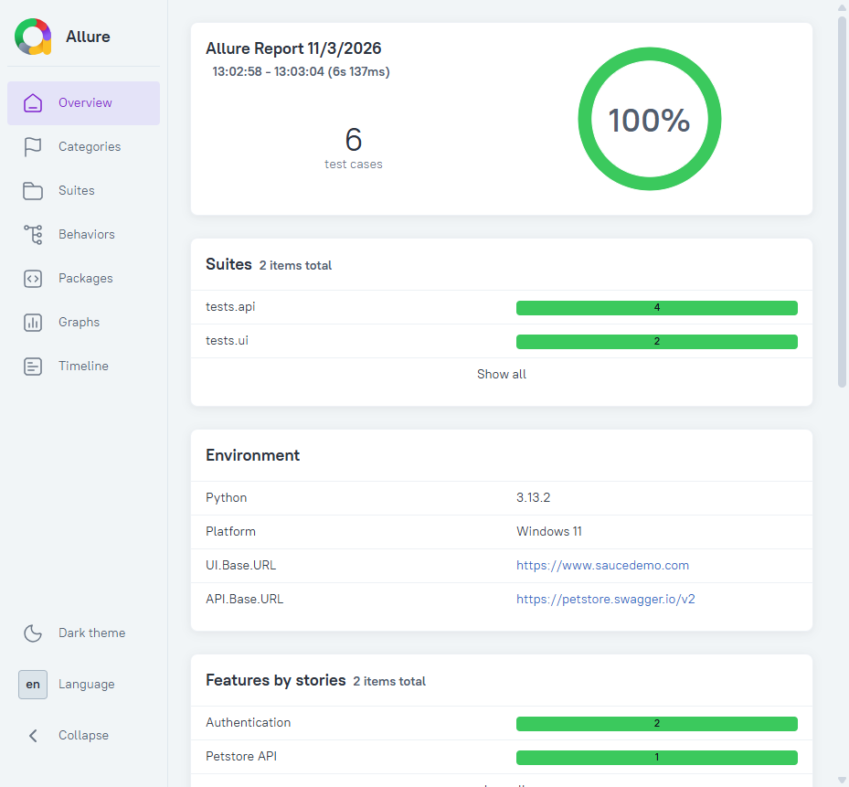

# Python Playwright Automation Lab

A Python test automation framework using [Playwright](https://playwright.dev/python/) and [pytest](https://pytest.org/), implementing the **Page Object Model (POM)** pattern for both UI and API tests

---

## Tech Stack

| Tool | Purpose |
|---|---|
| Python 3.13 | Language |
| pytest | Test runner |
| pytest-playwright | Playwright browser fixtures |
| pytest-html | HTML test report |
| allure-pytest | Allure report integration |
| python-dotenv | `.env` file loading |

---

## Prerequisites

- Python 3.11+
- Node.js (for `npm install -g allure-commandline`)
- Java 11+ (for Allure CLI — install via `winget install --id Microsoft.OpenJDK.17`)

---

## Setup

### 1. Clone and install dependencies

```bash
git clone <repo-url>
cd pythonplaywrightautomation-lab
pip install -r requirements.txt
playwright install
```

### 2. Configure environment variables

```bash
cp .env.example .env
```

Edit `.env` and fill in:

```
STANDARD_USERNAME=standard_user
PASSWORD=secret_sauce
LOCKED_OUT_USER=locked_out_user
PETSTORE_API_KEY=your_api_key
```

### 3. Set up pre-commit hooks (one-time)

```bash
pre-commit install
```

This installs a git hook that automatically lints and formats code before every commit.

### 4. Install Allure CLI (one-time)

```bash
# Windows
npm install -g allure-commandline
winget install --id Microsoft.OpenJDK.17

# Mac
brew install allure
```

---

## Project Structure

```
pythonplaywrightautomation-lab/
├── framework/
│   ├── api/
│   │   └── petstore_client.py       # PetStore API client (CRUD methods)
│   ├── pages/
│   │   └── saucedemo_login_page.py  # Saucedemo login page object
│   ├── support/
│   │   ├── base_ui_test.py          # Base class for UI tests (injects page + page objects)
│   │   └── base_api_test.py         # Base class for API tests (injects API client)
│   ├── testdata/
│   │   └── pet_payload.py           # Shared pet payload for API tests
│   └── utils/
│       ├── step_decorator.py        # @step decorator + context manager (pytest-html + Allure)
│       ├── api_helper.py            # attach_api_response() for logging/Allure JSON attachments
│       └── auth_helper.py           # get_api_auth_headers()
├── tests/
│   ├── ui/
│   │   └── test_saucedemo.py        # Login and product page UI tests
│   └── api/
│       └── test_petstore.py         # Petstore CRUD lifecycle API tests
├── scripts/
│   ├── show_report.py               # Serve pytest-html report (like npx playwright show-report)
│   └── show_allure_report.py        # Serve Allure report in browser
├── .github/
│   └── workflows/
│       └── playwright.yml           # CI: sharded test runs + Allure report publishing
├── Dockerfile                       # Docker image (reserved for future use)
├── conftest.py                      # pytest hooks: step table injection, env properties, base_url
├── pytest.ini                       # pytest config: paths, addopts, markers
├── requirements.txt
└── .env.example
```

---

## Running Tests

### All tests (UI + API)

```bash
pytest
```

### UI tests only (headed browser)

```bash
pytest tests/ui/ --headed
```

### API tests only

```bash
pytest tests/api/
```

### Run by marker

```bash
pytest -m login_and_product_page   # smoke tests
pytest -m negative_test            # negative tests
pytest -m incremental              # API CRUD lifecycle
```

### Specific browser

```bash
pytest tests/ui/ --browser firefox
pytest tests/ui/ --browser webkit
```

---

## Code Quality

Python equivalent of `npm run lint` / `npm run prettier`, using **[ruff](https://docs.astral.sh/ruff/)** — a single fast tool that replaces flake8, black, and isort.

| Command | Purpose |
|---|---|
| `ruff check .` | Lint the entire project |
| `ruff check . --fix` | Lint and auto-fix issues |
| `ruff format .` | Format code (like Prettier) |
| `ruff format --check .` | Check formatting without changing files |
| `pre-commit run --all-files` | Run all hooks against every file manually |

### Pre-commit hooks

**[pre-commit](https://pre-commit.com)** (Python's Husky equivalent) runs ruff automatically before every `git commit`. The hook is configured in `.pre-commit-config.yaml`.

After cloning the repo, install the hook once:

```bash
pre-commit install
```

From that point, every `git commit` will automatically lint and format your code. If ruff finds unfixable issues, the commit is blocked until they are resolved.

---

## Viewing Reports

### pytest-html report

```bash
pytest                         # generates reports/report.html
python scripts/show_report.py  # opens at http://localhost:9323/report.html
```

### Allure report (local)

```bash
pytest                                  # generates reports/allure-results/
python scripts/show_allure_report.py    # starts server + opens browser automatically
```

### Allure report from CI artifact

After a GitHub Actions run, download the **`allure-report`** artifact, extract the zip, then serve it:

```bash
# ~ expands to your home directory on Windows, Mac, and Linux
python scripts/show_allure_report.py --report ~/Downloads/allure-report
```

The script auto-detects `index.html` even if the zip extracted into a nested subfolder. Chrome opens automatically at `http://localhost:9324`.

> **Do not** open `index.html` directly in Chrome — Allure requires an HTTP server to load its data files. Opening via `file://` causes a `500 Failed to fetch` error.

---

## Framework Design

### Page Object Model

Page objects live in `framework/pages/`. Each class represents a page and exposes:
- `@property` locators
- Action methods decorated with `@step`

```python
class SaucedemoLoginPage:
    @step("Navigate to login page and submit credentials")
    def login(self, username: str, password: str) -> None:
        self.page.goto("/")
        self.username_field.fill(username)
        self.password_field.fill(password)
        self.login_button.click()
```

### Base Test Classes (OOP fixtures)

Instead of pytest fixture parameters, tests inherit from base classes:

```python
class TestSaucedemoLoginAndShopping(BaseUITest):
    def test_validate_standard_user_login(self):
        self.login_page.login(...)  # self.page and self.login_page injected by BaseUITest
        expect(self.page.locator(...)).to_be_visible()
```

### Step Decorator

`framework/utils/step_decorator.py` provides a `step` class that works both as a decorator and context manager, feeding **both** pytest-html and Allure simultaneously:

```python
# On page object methods
@step("Login with credentials")
def login(self, username, password): ...


# In test methods
with step("Assert app logo is visible"):
    expect(self.page.locator(".app_logo")).to_be_visible()
```

---

## CI/CD (GitHub Actions)

The workflow at `.github/workflows/playwright.yml` runs on push/PR:

1. **Sharded test jobs** — 3 parallel shards (UI + API)
2. **Allure report job** — merges shard results and publishes HTML report as artifact
3. **Docker publish job** — builds and pushes multi-arch image to GHCR on merge to `main`

**Before the workflow can pass, add these secrets in your GitHub repository:**
`Settings → Secrets and variables → Actions → New repository secret`

| Secret | Description |
|---|---|
| `STANDARD_USERNAME` | Saucedemo standard user login |
| `PASSWORD` | Saucedemo password |
| `LOCKED_OUT_USER` | Saucedemo locked-out user login |
| `PETSTORE_API_KEY` | Petstore API key (any non-empty string is accepted) |

> Without these secrets the CI workflow will fail on the UI and API test steps.

---

## VS Code Run Configurations

Open the **Run and Debug** panel (`Ctrl+Shift+D`) for pre-configured launch profiles:

| Profile | Command |
|---|---|
| Pytest: All Tests (Headless) | `pytest tests/` |
| Pytest: All Tests (Headed) | `pytest tests/ --headed` |
| Pytest: UI Tests Only (Headed) | `pytest tests/ui/ --headed` |
| Pytest: API Tests Only | `pytest tests/api/` |
| Pytest: Current File | runs the open file |
| Show Test Report | opens pytest-html report |

---

## Report Screenshots

### pytest-html Report



### Allure Report



---

## Docker (Future)

A `Dockerfile` is included for containerised test runs (Kubernetes / CI sharding). The image is based on `mcr.microsoft.com/playwright/python`.

```bash
docker build -t playwright-lab .
docker run --env-file .env playwright-lab
```
